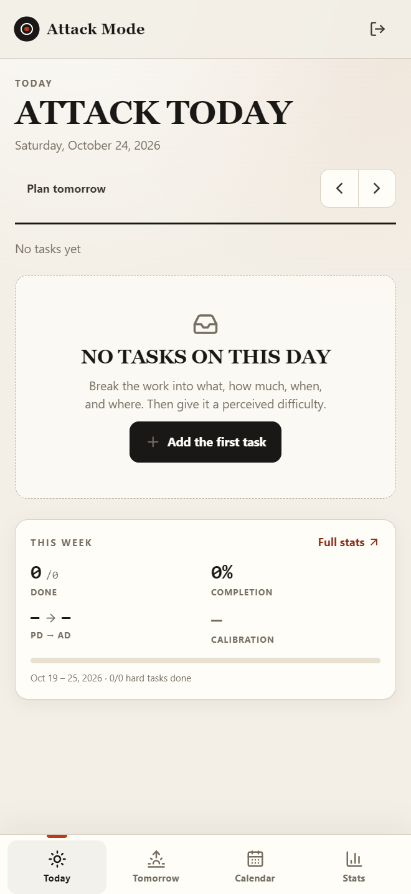
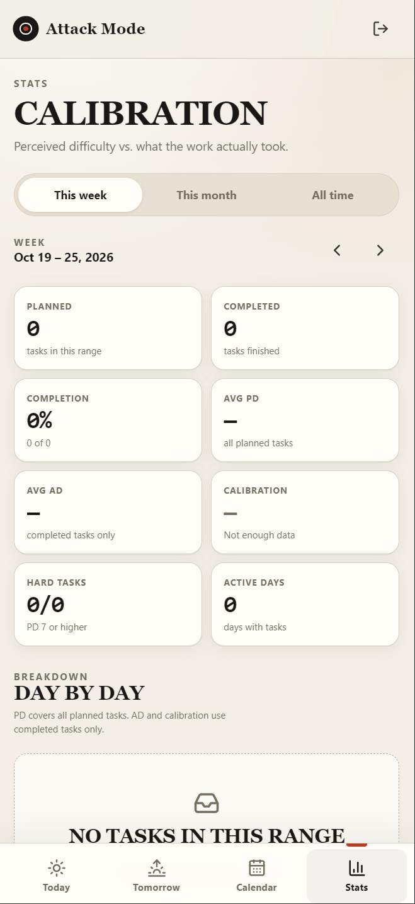
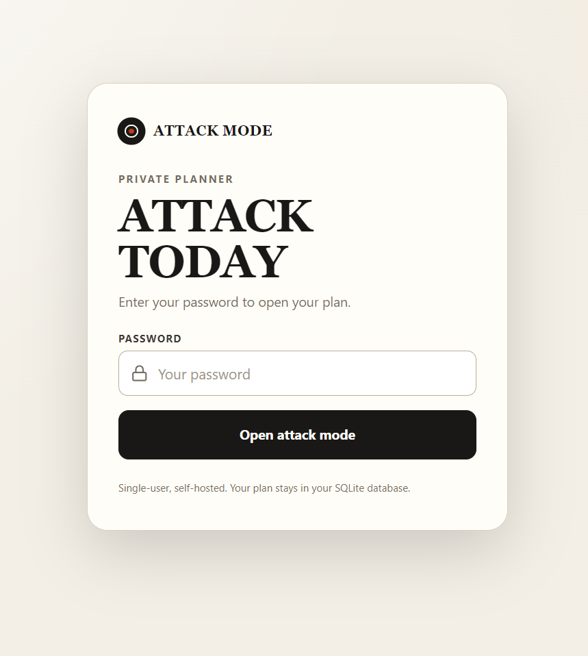

# Attack Mode

A private, single-user attack planner. The image is public, multi-arch, and needs no build tools or registry login.

## Screenshots

| Today | Stats | Log in |
|:---:|:---:|:---:|
|  |  |  |

## Run it

Create an empty directory and add these two files.

### `compose.yaml`

```yaml
services:
  attack-mode:
    image: ghcr.io/ksumesh431/planner_attack_mode:latest
    restart: unless-stopped
    read_only: true
    security_opt:
      - no-new-privileges:true
    cap_drop:
      - ALL
    ports:
      - "${HOST_PORT:-8001}:8080"
    environment:
      APP_ENV: production
      PORT: 8080
      DB_PATH: /data/attack.db
      APP_PASSWORD: ${APP_PASSWORD:?Set APP_PASSWORD in .env}
      COOKIE_SECURE: ${COOKIE_SECURE:-false}
      SESSION_TTL_HOURS: ${SESSION_TTL_HOURS:-720}
      TRUSTED_PROXIES: ${TRUSTED_PROXIES:-}
    volumes:
      - attack-data:/data
    tmpfs:
      - /tmp
    logging:
      driver: json-file
      options:
        max-size: "10m"
        max-file: "3"
    stop_grace_period: 10s

volumes:
  attack-data:
    name: attack-mode-data
```

### `.env`

```dotenv
APP_PASSWORD=choose-a-strong-password
HOST_PORT=8001
COOKIE_SECURE=false
SESSION_TTL_HOURS=720
TRUSTED_PROXIES=
```

Change `APP_PASSWORD` before starting. Set `COOKIE_SECURE=true` when serving over HTTPS.

### Start

```bash
docker compose up -d
```

Open <http://localhost:8001>.

No `docker login` or build step is needed; Docker pulls the matching AMD64 or ARM64 image from GHCR.

### Update

```bash
docker compose pull
docker compose up -d
```

### Stop

```bash
docker compose down      # stop, keep data
docker compose down -v   # stop and delete data
```

Data lives in the `attack-mode-data` volume and survives restarts, container recreation, and image updates.

## Install as an app

The app includes a web app manifest, icons, and a service worker, so it can be installed like a native app. This **requires HTTPS**: browsers will not install a PWA served from `http://IP:8001`.

Once the app is behind HTTPS, open it in Brave/Chrome on Android, use the browser menu, and choose **Install app**. The installed app is named **Attack Mode** and uses the target icon.

## Behind HTTPS

Set `COOKIE_SECURE=true` and put a reverse proxy with a real certificate in front of the container. A domain is required for a normal Let's Encrypt certificate; point its DNS record at the server and open ports 80 and 443.

For example, with Caddy on the host:

```caddyfile
planner.example.com {
    reverse_proxy 127.0.0.1:8001
}
```

Then set these in `.env` and restart:

```dotenv
COOKIE_SECURE=true
TRUSTED_PROXIES=127.0.0.1
```

For Caddy inside the same Compose network, proxy to `attack-mode:8080` and set `TRUSTED_PROXIES` to the Docker network CIDR (for example `172.16.0.0/12`). A Cloudflare Tunnel is another option if you do not want to expose ports.

Architecture, development, backups, API, and security notes are in [architecture.md](architecture.md).
